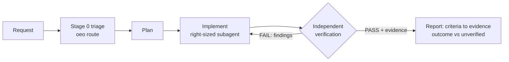

# Open Engineering Organization (OEO)

A Claude Code plugin that gives AI coding agents a **proportional operating model**. Requests
are triaged, only the roles they need are activated, each role runs on a right-sized model, the
implementer never verifies its own work, and every claim of success needs evidence.

> Status: **v0.2.0, early.** The router, contracts, checks and hooks have 176 unit tests
> (CI: Linux and macOS). The installed plugin has run end to end on 9 scenarios, each against a
> plain-Claude baseline: [results and costs](evals/results/agentic/SUMMARY.md) ·
> [what each run changed](evals/results/agentic/NOTES.md). This is evidence, not a benchmark, and
> it has limits:
> - one baseline run per scenario and 1-5 OEO runs;
> - the scenarios were used both to improve OEO and to evaluate it;
> - the author wrote the fixture, the checks and the plugin;
> - no grading was blind, and every run was headless, so human-approval steps are untested.
>
> See [ROADMAP.md](ROADMAP.md).

**What the runs show.** The main session ran on `sonnet` and subagents on the `economy` profile.
- **Cost:** OEO costs 1.1-2.3x plain Claude for typo, verify-only, status and release work, and
  3.3-7.7x for discovery, auth fix, research, launch and dashboard ($0.29-0.74 vs $0.07-0.11).
- **Wall time:** up to 13x longer (launch: 455 s vs 34 s).
- **Shared outcome checks:** these are files, tests and behavior probes. Plain Claude matches OEO
  on the typo, the auth fix, the dashboard, launch copy and the status brief.

Where OEO behaved differently:
- **Release:** OEO blocked a changelog claim the code contradicted; plain Claude prepared a
  release containing it. Neither published, as instructed.
- **Auth fix:** an independent security review, and a test shown to fail without the fix.
- **Research:** a ledger tagging every claim observed, inferred or unknown; QA rejected
  overclaims until they were fixed.
- **Vague request:** OEO wrote a brief that passes `brief-check`. Plain Claude answered in chat
  instead; it was not asked for a brief file, so this is not a quality comparison.

Use OEO when being wrong costs more than the extra time and tokens.

## Why
Agents usually fail in one of two ways. A single agent writes code and declares it done with no
independent check. Or a "virtual company" of 30 personas burns tokens on ceremony for a typo.
OEO's answer is **proportionality**, decided by a deterministic router instead of prose:

| Request | Class | What activates |
|---|---|---|
| Fix a README typo | A, trivial | the orchestrator fixes it; one independent verifier subagent checks |
| Well-defined bug fix | B, standard | Tier 1 core; most roles are checklists, 2 subagents |
| Auth change / new product surface | C, significant | + business analyst, architect, security, design... only those whose domain is touched |
| Release, licensing, governance | D, organizational | maintainer-led + triggered advisors (release, legal, ...) |

## What's inside
- **37 role contracts** ([catalog](docs/roles.md)) in three tiers, each validated against
  [a schema](schemas/role.schema.json), with a [decision-rights matrix](org/decision-rights.yaml)
  (who decides, who can veto and on what grounds).
- **A deterministic router**: the agent reports facts (type, domains, signals, size), and
  `scripts/oeo.py route` returns the class, roles (with reasons), models, skills, gates and token budget.
- **9 skills**, one owner per capability ([ADR 0008](docs/adr/0008-one-owner-per-capability.md)):
  `/oeo:deliver` (orchestrator), `business-review` (brief, PRD, red-team), `research` (learn how
  company X does feature Y), `design-direction` (DESIGN.md, anti-slop), `verify` (incl. real-browser
  UI evidence), `release`, `launch` (positioning and copy), `finops`, `chief-of-staff` (status and
  decisions). **12 agents**, generated from the contracts.
- **Model routing as config** ([docs](docs/model-routing.md)): contracts name tiers, not models.
- **Safety hooks**: asks you before destructive or publishing commands and before writing likely
  secrets; logs subagent token use locally. OEO's scripts and hooks make no network calls and
  collect no telemetry.
- **Open-source plumbing**: provenance registry ([THIRD_PARTY.md](THIRD_PARTY.md)), license gate,
  SBOM, CI, [evals](evals/README.md), [ADRs](docs/adr/README.md), [threat model](docs/threat-model.md).


Details: [docs/architecture.md](docs/architecture.md).

## Install (2 minutes)
Requires Claude Code with plugin support and `python3` (3.10+) on `PATH` (CI covers Linux; macOS should work;
Windows untested).
```
/plugin marketplace add Tima299/open-engineering-organization
/plugin install oeo@open-engineering-organization
```
Releases will be tagged `vX.Y.Z`; once one exists, pin it with
`/plugin marketplace add Tima299/open-engineering-organization#vX.Y.Z`. No release tag exists yet.

## Quickstart (under 15 minutes)
1. Get a practice repo: clone this repository and copy `examples/taskboard` somewhere, then run
   `git init` in it and commit. It is a tiny Python to-do service with seeded defects.
2. Open Claude Code in that folder and try a trivial task:
   `/oeo:deliver Fix the typo "recieve" in README.md`. Expect Class A, one verifier subagent, a
   one-word diff, and a verifier report with the command it ran.
3. Try a significant one:
   `/oeo:deliver Users say they can delete other people's tasks. Fix it.` Expect Class C (auth
   domain): a short brief with acceptance criteria for you to approve, a fix with a regression
   test, a security review, and a verification table. This is the expensive path: the
   latest installed-plugin auth run (eval 07) cost $0.49, about 5.5x plain Claude, with the economy profile.
4. See what it cost: run `/oeo:finops`.

Preview triage without running agents (from a clone of this repo):
```bash
python3 scripts/oeo.py route --type bugfix --touches auth,backend --files 2 --lines 30
```

## Configuration
| Variable | Effect |
|---|---|
| `OEO_MODEL_PROFILE=economy` | Cheaper model mapping in router output ([profiles](config/models.yaml)) |
| `OEO_GUARD=off` | Disable the confirmation guard hook |
| `OEO_FINOPS=off` | Disable subagent token logging |

Files OEO writes in your project, and only when you ask for that kind of work:
- `.oeo/<engagement>/`, one folder per triaged request: brief, plan, risks, verification,
  design spec, research ledger and teardown, `evidence/`, `raw/`.
- `.oeo/` (shared): `decisions.md`, `product-marketing.md`, `activation-log.jsonl`,
  `finops.jsonl`, and `sessions/` with token snapshots. `oeo status` summarizes all of it.
- Deliverables: `DESIGN.md`, `docs/adr/*`, `CHANGELOG.md`.

Suggested `.gitignore`: `.oeo/*.jsonl`, `.oeo/sessions/`, `.oeo/*/evidence/`, `.oeo/*/raw/`.

## Uninstall
```
/plugin uninstall oeo@open-engineering-organization
/plugin marketplace remove open-engineering-organization
```
This removes the plugin, its agents, skills, hooks and plugin data directory. It does **not**
delete `.oeo/` folders inside your projects (they are your project's records); remove them by
hand if you want. OEO's scripts and hooks send nothing anywhere. If you ask for research,
Claude Code's web tools (and any adapter you installed, such as Firecrawl) send queries to the web
or to that vendor.

## Optional companions
OEO works without any other skill. The best ideas of 20 community projects are already adapted
into OEO's own skills, credited per project in [THIRD_PARTY.md](THIRD_PARTY.md). If you also
have some of them installed, the router suggests them where they add power:
- Engineering: Superpowers, Ponytail.
- Research: last30days, Firecrawl, Playwright CLI, rea (authorized use only).
- Product and marketing: pm-skills, marketingskills.
- Design: frontend-design, Open Design, Awesome Design, Impeccable, UI UX Pro Max, Taste, Emil Kowalski's skills.

OEO never installs or bundles them.

## Limitations (read before relying on it)
- Model routing is policy. Your settings or environment variables can override it, so check
  `.oeo/finops.jsonl` for what actually ran ([details](docs/model-routing.md)).
- The guard hook is pattern-based defense in depth, not a sandbox.
- Token logging parses Claude Code's internal transcript format and may break when it changes.
  Main-session tokens are not counted.
- Triage quality depends on the agent reporting facts honestly. The router rejects unknown
  vocabulary and refuses Class A without a size estimate.
- One maintainer today (see [GOVERNANCE.md](GOVERNANCE.md)).

## Contributing
Read [CONTRIBUTING.md](CONTRIBUTING.md). The main CI checks:
```bash
python3 -m pip install --require-hashes -r requirements-dev.txt
python3 scripts/oeo.py validate && python3 scripts/oeo.py build --check
python3 -m unittest discover -s tests -t . && python3 evals/run.py --no-write
```
[Code of Conduct](CODE_OF_CONDUCT.md) · [Security](SECURITY.md) · [Support](SUPPORT.md) ·
[Governance](GOVERNANCE.md) · [Changelog](CHANGELOG.md)

## License
[Apache-2.0](LICENSE). Contributions are accepted under the same license (DCO sign-off); see
[ADR 0005](docs/adr/0005-apache-2-and-dco.md).
